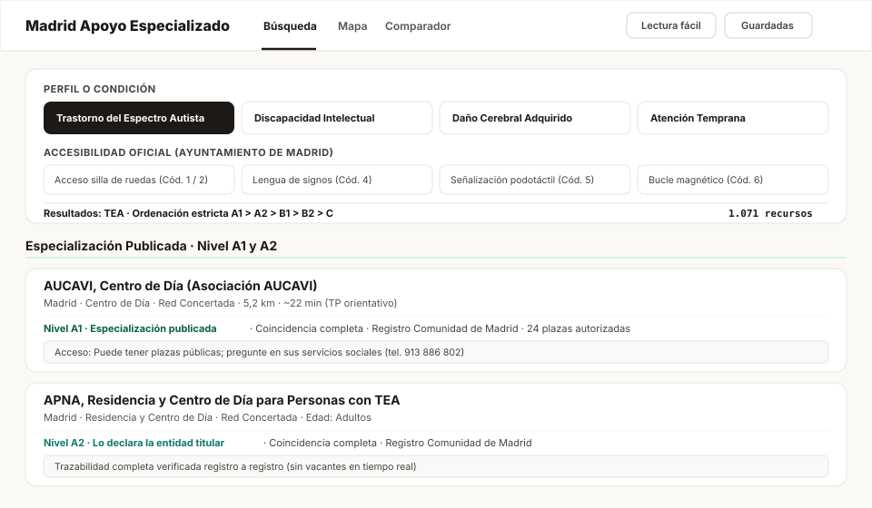
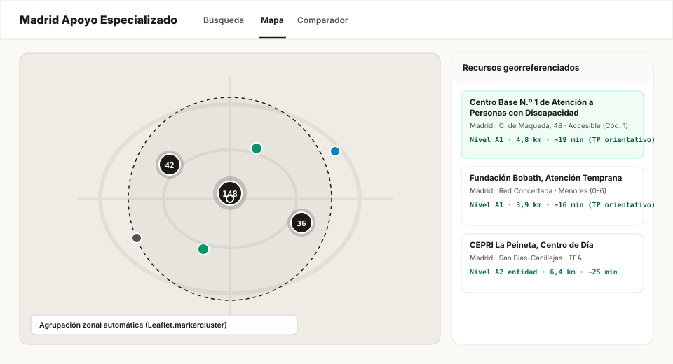

# Madrid Apoyo Especializado v1.8 (DATAMAD 2026)

Buscador ciudadano basado en datos abiertos oficiales para localizar **recursos de atención social autorizados** en la Comunidad de Madrid y el Ayuntamiento de Madrid, con trazabilidad registro a registro y explicabilidad algorítmica.

- **Demo publicada (GitHub Pages):** `https://<tu-usuario>.github.io/<tu-repositorio>/` *(despliegue automático en cada actualización de `main` mediante [`.github/workflows/deploy-pages.yml`](.github/workflows/deploy-pages.yml))*.
- **Licencia de código abierto:** [Apache License 2.0](LICENSE) (`SPDX-License-Identifier: Apache-2.0`).

## Capturas de la Aplicación

| Búsqueda y filtros acumulativos | Mapa territorial con agrupación zonal |
| :---: | :---: |
|  |  |

## Método de Clasificación: Niveles de Evidencia y Reglas Negativas

El motor ordena los resultados de forma estrictamente lexicográfica (`A1 > A2 apoyo > A2 entidad > B1 > B2 > C`) para que **la cercanía geográfica nunca sitúe un recurso genérico por delante de un centro especializado confirmado**:

1. **Niveles de Evidencia:**
   - **`A1` (Especialización publicada):** El centro o su registro oficial declara expresamente el perfil o condición y el servicio de apoyo buscado.
   - **`A2` (`A2` por apoyo o `A2` por entidad titular):** El centro publica el perfil, aunque falta confirmar algún apoyo específico —o bien la especialización consta por la entidad titular (por ejemplo, asociaciones monográficas de TEA o daño cerebral)—; se muestra siempre el matiz para confirmarlo con la sede.
   - **`B1` (Servicios relacionados):** Recursos afines del sector asistencial que comparten área funcional o apoyos próximos.
   - **`B2` (Posible recurso / limitado por regla negativa):** Centros del sector cuya denominación o ficha requiere confirmación directa antes de asumir especialización clínica.
   - **`C` (Orientación general):** Resto de centros sociales compatibles por etapa vital y accesibilidad, útiles como orientación para servicios sociales.
2. **Reglas Negativas de Inferencia (limitan evidencia, no excluyen):**
   - Impiden extrapolaciones clínicas sin respaldo registral (por ejemplo: *discapacidad intelectual no implica TEA*, *centro ocupacional no equivale a terapia ocupacional clínica*, *salud mental crónica no equivale a neurología*).
   - Cuando una regla negativa aplica, el centro **no desaparece como incompatible**: su nivel queda limitado como máximo a `B2` o `C` con aviso explícito de confirmación. Solo excluyen de la lista principal la **etapa vital incompatible** declarada y la **accesibilidad física solicitada** cuando el código oficial del centro no la acredita.

## Requisitos e Instalación

### Requisitos previos
- Node.js >= 20.0.0
- npm >= 9.0.0

### Pasos de instalación

```bash
npm install
npm run dev
```

El servidor estará disponible en `http://localhost:3000`.

## Comandos Disponibles

- `npm run dev`: Inicia el servidor de desarrollo en el puerto 3000.
- `npm run ingest`: Descarga los 3 CSV oficiales abiertos, verifica sus firmas SHA-256 byte a byte en disco, calcula diferencias reales (`snapshot-diffs.json`, comparando contra la última captura publicada antes de sobrescribir y conservando el informe si las huellas coinciden) y regenera `catalog-classified.json`.
- `npx tsx scripts/ingest.ts --only-classify`: Re-clasifica offline los 3 CSV vigentes en disco sin descargar ni alterar las capturas ni sus huellas SHA-256.
- `npm test`: Ejecuta la batería automatizada de pruebas de Vitest sobre el motor y el catálogo oficial real.
- `npm run lint`: Comprobación estricta de tipos TypeScript (`tsc --noEmit`).
- `npm run build`: Compila la aplicación web y el Service Worker PWA offline en `dist/`.
- `npm run preview`: Previsualiza la compilación de producción.

## Atribución de Datos Abiertos, Fechas y Licencias de Reutilización

Este proyecto reutiliza exclusivamente conjuntos de datos públicos oficiales publicados en los portales de datos abiertos del **Ayuntamiento de Madrid** y de la **Comunidad de Madrid**. La fecha exacta de la última captura verificada y las huellas SHA-256 vigentes se leen dinámicamente de [`public/data/snapshots/snapshot-metadata.json`](public/data/snapshots/snapshot-metadata.json) y se actualizan cada lunes mediante GitHub Actions:

| Conjunto de datos | Organismo fuente | Fichero vigente / formato | Licencia / Condiciones de reutilización |
| :--- | :--- | :--- | :--- |
| [Catálogo de Centros de Atención Social (`212774-0-atencion-social`)](https://datos.madrid.es/dataset/212774-0-atencion-social) | **Ayuntamiento de Madrid** (`datos.madrid.es`) | `snapshot-latest.csv` (codificación `Latin-1`, ver fecha en `snapshot-metadata.json`) | [Condiciones generales de reutilización del Ayuntamiento de Madrid](https://datos.madrid.es/egob/catalogo/aviso-legal) (reutilización libre con cita de la fuente y sin desnaturalizar la información) |
| [Registro General de Centros de Atención Social](https://datos.comunidad.madrid/dataset/atencion_social_registro_centros) | **Comunidad de Madrid** (`datos.comunidad.madrid`) | `cam-centros-latest.csv` (codificación `UTF-8`, ver fecha en `snapshot-metadata.json`) | [Licencia CC BY 4.0 / Condiciones de reutilización de la Comunidad de Madrid](https://datos.comunidad.madrid/condiciones-de-uso) |
| [Registro General de Servicios de Atención Social](https://datos.comunidad.madrid/dataset/atencion_social_registro_servicios) | **Comunidad de Madrid** (`datos.comunidad.madrid`) | `cam-servicios-latest.csv` (codificación `UTF-8`, ver fecha en `snapshot-metadata.json`) | [Licencia CC BY 4.0 / Condiciones de reutilización de la Comunidad de Madrid](https://datos.comunidad.madrid/condiciones-de-uso) |
| Cartografía base del visor | **OpenStreetMap contributors** | Teselas en línea en la pestaña Mapa | [Open Database License (ODbL)](https://www.openstreetmap.org/copyright) |

*(Los registros sanitarios de REGCESS no forman parte de la ingesta automática actual de atención social y quedan documentados para fases de interoperabilidad futura).*

## Política de Capturas y Rigor Metodológico

1. **Política unificada de capturas (`-latest` + diffs + historial Git):** Para evitar el crecimiento del repositorio con copias CSV duplicadas cada semana, en `public/data/snapshots/` **solo se conservan los últimos ficheros `-latest.csv`**, la firma `snapshot-metadata.json`, el informe de diferencias reales `snapshot-diffs.json` (que incluye cambios de coordenadas y accesibilidad) y el catálogo pre-clasificado `catalog-classified.json` (cargado bajo demanda y cacheado offline por la PWA). El histórico completo de versiones semanales queda trazado en los *commits* de Git.
2. **Accesibilidad física literal (Ayuntamiento de Madrid):** El filtro distingue estrictamente por los códigos oficiales de la ficha de estructura municipal: `1` (accesible), `2` (parcialmente accesible), `4` (lengua de signos), `5` (señalización podotáctil) y `6` (bucle magnético); el código `3` (*sin información*) nunca se considera accesible.
3. **Distancias y Tiempos Orientativos:** Las distancias se calculan mediante fórmula Haversine desde el origen elegido (GPS efímero, centroide municipal oficial o Madrid Centro por defecto) y el tiempo en transporte público mostrado es una estimación matemática orientativa en función de la distancia lineal, **no** una consulta en tiempo real a horarios CRTM/Metro/EMT.
4. **Privacidad Efímera y Cero Telemetría (RGPD):** Sin cuentas, sin fuentes externas ni Google Fonts (tipografías servidas localmente desde el propio paquete), sin telemetría de consultas ni almacenamiento de datos de salud o coordenadas en servidor; anonimización de titulares personas físicas en servicios individuales sin NIF jurídico.

## Licencia del Código

Código fuente licenciado bajo **Apache License 2.0** ([`LICENSE`](LICENSE)). Los datos abiertos mantienen la titularidad y condiciones de reutilización de sus respectivas administraciones públicas citadas arriba.
